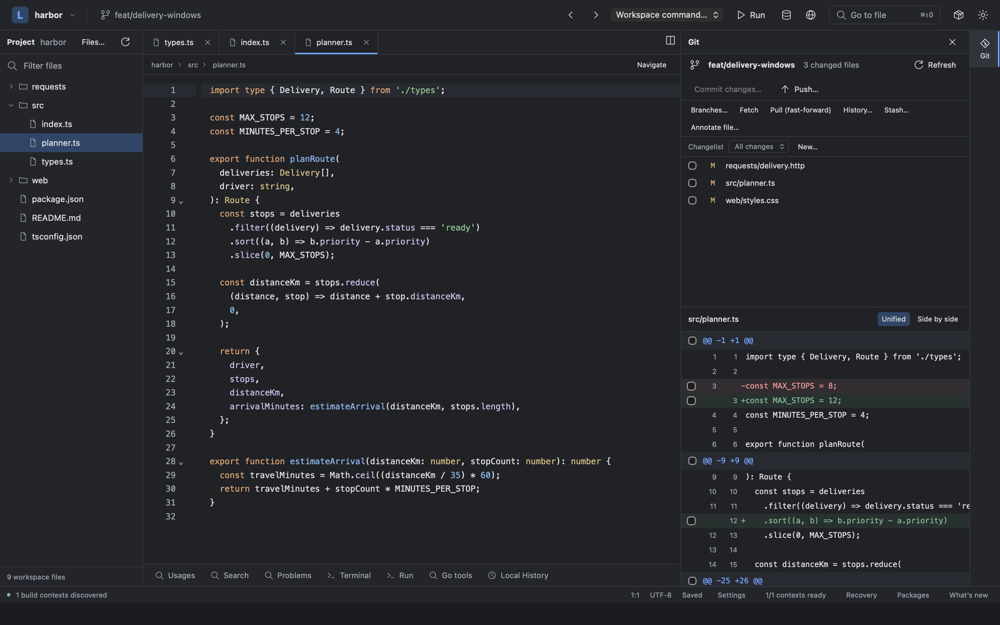

# Zwip

**Modern lean IDE for faster productivity.**

A general-purpose macOS IDE built around code navigation, reviewable Git operations, and language support you install when you need it.

**Personal preview · Apple Silicon · Tauri, Rust and CodeMirror**



_Workspace capture from before the current branding; see the [screenshot provenance](site/public/images/README.md)._

[Get started](#build-and-run) · [Preview status](docs/status.md) · [Development guide](docs/development.md) · [Sidebar layout](docs/sidebar-layout.md) · [Product site](site/README.md) · [GitHub](https://github.com/grejojoby/zwip-ide)

## Follow code and review changes

- **Semantic code navigation.** Cmd-click a usage to open its declaration, or a declaration to explore its usages. Follow implementations, interface relationships and call hierarchies. Results report incomplete analysis instead of presenting a failed search as an empty answer.
- **Git beside your editor.** Move Git to either sidebar, including beside Project, and switch tools with a click. Your workspace remembers the arrangement. Commit selected files, hunks or lines; resolve three-pane merges; review outgoing changes before pushing.
- **A compact workspace.** Tabs, split editors, project and symbol search, navigation history, light and dark themes, and configurable keyboard shortcuts.
- **Recoverable editing.** Unsaved-buffer recovery, Local History and reviewed rename edits help preserve work. External file changes do not silently replace dirty buffers.
- **Focused search.** Right-click a folder to exclude it from search and indexing, and review exclusions in Settings. Preview Markdown live beside the editor.
- **Tools on demand.** Install language and tool packages separately. Save named run configurations, use the integrated terminal, and see new features in the in-app update history.
- **Bring IntelliJ settings.** Preview custom keybindings, database connections, supported npm/Go run and debug configurations, and compatible light/dark appearance settings from XML, a settings ZIP or a configuration folder. See the [import guide](docs/intellij-import.md) for supported mappings and limitations.

## Install the capabilities you need

The core is general-purpose. Go and Web are the initial language packages, with additional tools installed through the same package manager.

| Package             | Includes                                                                                                               |
| ------------------- | ---------------------------------------------------------------------------------------------------------------------- |
| **Go**              | Semantic navigation, completion, diagnostics, rename, run/test/coverage and Delve debugging across independent modules |
| **Web**             | JavaScript, TypeScript, HTML and CSS; JS/TS semantic navigation and editor services; JSX/TSX support                   |
| **React / Next.js** | Framework integration through the project's Next.js TypeScript plugin; requires Web                                    |
| **SQL**             | MySQL, PostgreSQL and SQLite browsing, paged queries and reviewed row edits                                            |
| **Redis**           | Read-only incremental key scans, typed values and TTL inspection                                                       |
| **HTTP**            | Requests, environments, response inspection and cancellation                                                           |

Packages are installed and enabled separately. Language workers start on demand; building the app does not enable them automatically. See the [provider contracts and limitations](docs/protocol.md).

## Build and run

Use Apple Silicon macOS, **Node.js 24.16.0 exactly**, Rust and Xcode Command Line Tools. Building the Go package also requires the configured Go 1.25.5 toolchain. Its default path is `/Users/grejo.j/.gvm/gos/go1.25.5/bin/go`; see the [development guide](docs/development.md#prerequisites) for explicit toolchain configuration.

```sh
git clone https://github.com/grejojoby/zwip-ide.git zwip
cd zwip
npm ci
npm run build:packages
npm run dev
```

In **Packages**, choose **Install directory…**, select a package under `dist/packages/`, then **Enable** it. Install and enable Web before React/Next. To install local ZIPs instead:

```sh
node scripts/package-catalog.mjs --archives-only
```

Choose **Install archive…** and select a ZIP from `dist/catalog/`. No public package catalog is configured by default.

```sh
npm run build # Creates target/release/bundle/macos/Zwip.app
```

The current app targets macOS 13.5 or later; only macOS 27.0.1 has been exercised. Local builds are ad-hoc signed, without Developer ID signing or notarization.

## Preview status

Zwip is a personal preview, **not yet a qualified daily-driver release**. Navigation correctness and native workflow tests provide useful evidence; resource usage still needs controlled production measurements. Production workflow coverage, physical input, IME and accessibility qualification remain in progress.

Read the [implementation and acceptance status](docs/status.md) for evidence and limits, or the [benchmark method](docs/benchmark-method.md) for measurement methods and recorded observations.

## Development

```sh
npm run check          # TypeScript, lint, formatting and Rust static checks
npm test               # Frontend, Web and tool-service tests
cargo test --workspace # Rust services and disposable Git workflows
npm run test:go        # Pinned Go provider integration tests
```

The [development guide](docs/development.md) covers native tests, package builds, toolchain details and the repository structure. The [product site](site/README.md) runs separately with `npm run dev:site` on port 1421; `npm run build:site` writes `dist/site` and `npm run preview:site` previews that build.

For contributions, follow [AGENTS.md](AGENTS.md), keep behavior and limitations explicit, and add an entry to the [update history](docs/update-history.md) with each delivered change. Report reproducible problems through [GitHub Issues](https://github.com/grejojoby/zwip-ide/issues).
